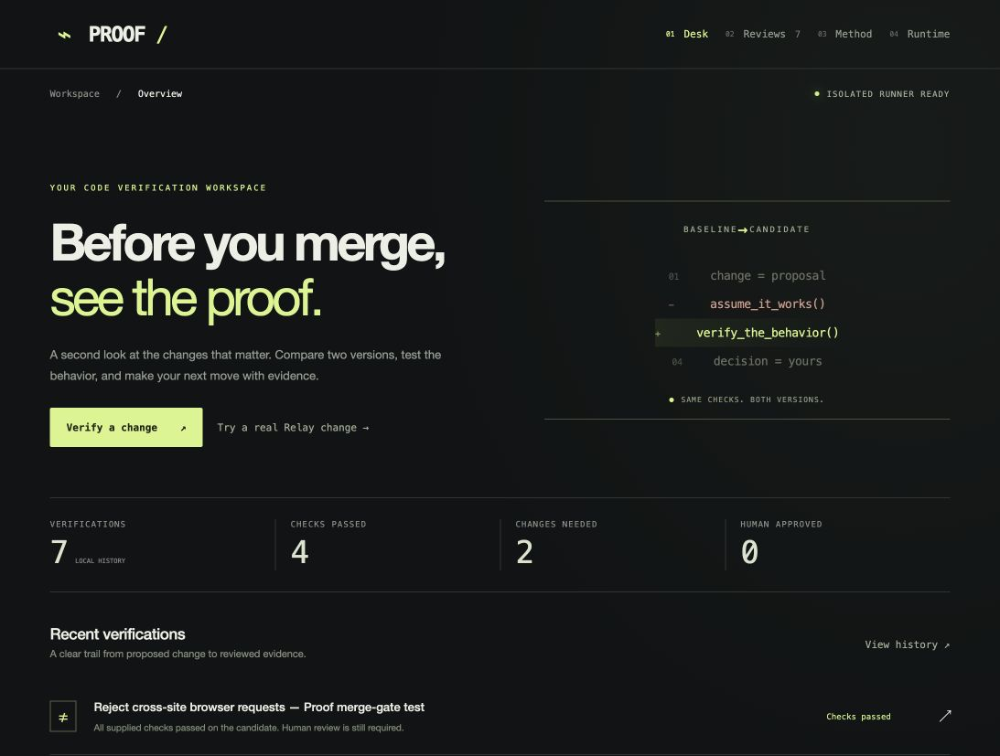

# Proof — Verify before you merge

A standalone local review desk for small FastAPI code changes. Supply two source snapshots and shared HTTP contracts, then compare actual results from separate Docker containers. A dark graphite / lime interface puts code differences and before/after evidence first.



[Verified real PR workflow](https://github.com/saicharanteja-vulli/relay-agent-gateway/pull/1): failing required check blocked merging; the correction passed all four candidate checks in GitHub and locally. The PR was left unmerged.

## Start

Requires Python 3.11+ (tested with 3.14), Docker Desktop or a working Docker Engine, and a browser. No Orbit or Relay installation is needed.

```sh
sh setup-runner.sh  # once; downloads official Python and PyPI packages
sh start.sh        # creates an independent virtual environment
```

Open **http://127.0.0.1:8100**. Override the UI port with `PORT=8101 sh start.sh`.

The server only listens on loopback. Do not expose it through a tunnel or public proxy. It has no account system; local processes and other users with access to your local API may operate it.

## Try a real code change

Click **Try a real Relay change**. This loads source-only snapshots of the actual Relay FastAPI app and a proposed defense-in-depth patch that rejects `Sec-Fetch-Site: cross-site`. The baseline predates this patch; the candidate adds the check. No accounts, databases, API keys or live data are included.

The five shared checks cover:

1. Normal setup status: 200 with `setup_required: true` on both versions.
2. Cross-site setup-status request: baseline 200 → candidate 403.
3. Private `/api/me` without login: 401 on both versions.
4. Invalid login payload: 422 on both versions.
5. Missing dashboard header: 403 on both versions.

The example does not modify or restart the real Relay installation. The source change is a proposal, not a claim that the baseline exposes user account data through this public setup-status endpoint.

Review the exact checks and execution consent before running. Source snapshots and check definitions are immutable after submission and identified by SHA-256. Each completed report records the resolved Docker image ID.

## Your own project

Select the baseline folder and candidate folder. Enter a FastAPI import target such as `app:app` or `service.main:app`. Submit JSON checks:

```json
[
  {
    "name": "Private profile requires authentication",
    "method": "GET",
    "path": "/api/me",
    "expected_status": 401
  },
  {
    "name": "Health contract remains stable",
    "method": "GET",
    "path": "/health",
    "expected_status": 200,
    "expected_json": {"status": "ok"}
  }
]
```

Optional `headers`, `body` (JSON object or list), and `expected_json` (recursive object subset) are supported. JSON scalar values are type-sensitive. Checks run sequentially, in the same order for both versions. They do not retain cookies between requests. Each version starts with fresh temporary storage. This first version targets stateless or simple self-contained APIs; authenticated multi-step workflows need additional support.

Files: up to 80 per version, 150,000 characters per file, 2 MB total per version, 5 MB HTTP submission. The browser conservatively limits each file to 150 KB. Relative paths only; hidden files, data directories, virtual environments, compiled files and unsupported file types are excluded. Upload only source you own or have reviewed. Do not include production credentials or customer information in source, headers or request bodies.

## Results mean exactly this

- **Checks passed:** all supplied checks pass on the candidate. It is not proof of overall correctness or security.
- **Changes needed:** one or more candidate checks fail. Baseline pass → candidate fail is a regression. Failure on both is an existing failure, not hidden.
- **Inconclusive:** startup, timeout or incomplete execution prevents comparison. No pass is inferred.
- Baseline fail → candidate pass is an improvement. Identical versions are explicitly disclosed in Coverage & scope.

Requirement text and bounded code excerpts can generate a local AI test proposal. After human review, deterministic HTTP probes collect evidence; a model does not decide the verdict. It does not run a project's pytest suite, perform a full security scan, or install its requirements.

## Isolation and trust boundary

- Separate Docker containers for baseline and candidate; `--network=none`, no published ports.
- Read-only filesystem and source mount; 32 MB temporary writable filesystem.
- App user 65534, probe user 1001; no Linux capabilities; no-new-privileges.
- One CPU, 256 MB memory, 64 processes. Startup deadline, per-request timeout and bounded response evidence.
- Fixed Python / FastAPI / Uvicorn / Pydantic / HTTPX environment. No shell commands supplied by the user; no uploaded code imported on the host; no Docker socket mounted into containers.
- No host environment or app credentials forwarded. Relay, Orbit and Aegis data paths are redirected to fresh container `/tmp` paths.
- Normal completion/failure removes the test container and temporary source copy. Docker logging is bounded. A hard host crash can leave an orphan container: inspect `docker ps -a --filter label=proof.managed=true` and remove only the relevant Proof test container before retrying.

**This is for reviewed local code, not hostile multi-tenant execution.** Docker requires substantial host privileges and containers are not a perfect security boundary. Submitted code controls its responses and can intentionally satisfy checks. Proof cannot establish developer intent, resist every malicious application, or prove untested behavior.

## Decisions, history and privacy

SQLite stores source snapshots, requirements, checks, report evidence and decisions in `data/proof.db` (private directory 0700, database 0600). This is access control, not encryption at rest. Reports redact common secret patterns best-effort; checks and source may still contain sensitive information. Inspect before sharing.

A local reviewer must explicitly confirm review. Only complete passing reports can be approved. Rejection is available for any completed report. Decisions cannot be overwritten. Re-run as a new review for further changes. **No decision merges code, calls GitHub or deploys anything.** Approval identities are not authenticated in this local single-user MVP.

The UI lists the latest 100 reviews; all records remain in the local database. One review runs at a time, with at most three queued/running. Restart marks interrupted reviews failed rather than claiming success.

## Validation

66 automated tests cover input boundaries, result classification, approval gating, immutable decisions, storage privacy and restart handling. Real Docker and browser checks are run separately.

```sh
.venv/bin/python -m pytest -q
# Optional real Docker regression control, with Proof running:
.venv/bin/python tests/real_workflow.py
```

The real workflow deliberately removes `/api/me` authentication in an isolated Relay source copy. Proof must report baseline 401 → candidate 200 as a regression, mark the review blocked and reject approval with HTTP 409. Never apply that control mutation to a live app.

## Current scope

Local folder snapshots, user-authored API assertions, persistent history, code diffs, response evidence, Markdown/JSON exports and local decisions. Local AI test proposals require review before execution. Public GitHub PR import and required GitHub Actions checks are supported; private repositories and automatic merging are not.


## Local AI test proposals

Click **Generate tests with local AI** after loading both source versions and entering the requirement. Proof sends bounded AST source excerpts and the candidate diff to Ollama at `127.0.0.1:11434`. The default model is `qwen3:1.7b`; set `PROOF_MODEL` before starting to use another installed model. No cloud endpoint is used and source is never imported during generation.

Generation produces an editable JSON test plan, rationale and coverage limitations. It does not start Docker or create a verification run. Review every request, status and JSON assertion, edit or remove mistakes, check the test-review confirmation, and separately authorize code execution. Changes to the requirement, title, entrypoint or source invalidate the proposal; changes to tests clear the UI confirmation. The server rejects an unreviewed proposal or one for different source inputs. The original proposal and the final edited checks are retained separately, linked by proposal ID and immutable input hashes.

AI-generated expectations are suggestions, not an oracle. Bounded excerpts may miss code, dynamic routes or indirect dependencies. The local model may produce incomplete or incorrect checks; model failure never triggers execution. This app remains a local single-user tool, without multi-user authentication. GitHub enforcement requires the repository setup below.


## GitHub pull requests and required checks

In **Verify a change**, paste a public GitHub PR URL and click **Import public PR**. Proof downloads bounded source snapshots at immutable base and head commits, without running them. If the base has `.proof/policy.json`, its entrypoint and checks populate the form. Review the tests and consent before running. Source edits or a changed PR head/base are rejected at submission; re-import to test the new revision. Reports record both commit IDs. **Refresh GitHub merge checks** shows current GitHub checks and whether the imported commits have become stale.

A local pass does not publish a GitHub check or unlock a merge. Repository CI runs the committed base-branch policy, independently of editable local AI drafts. The installable template is in `integrations/github/`: place `verify_pr.py` and your reviewed `policy.example.json` at `.proof/verify_pr.py` and `.proof/policy.json`, and put `proof.yml` at `.github/workflows/proof.yml` on the base branch. The self-contained verifier builds its reviewed Docker image, reads the policy from the base SHA, executes application code only inside restricted containers and exits nonzero for failing or inconclusive results. It prints results and a GitHub Actions summary. No credentials are mounted into test containers. The workflow uses read-only permissions and has no path filters or skip-on-draft condition.

Configure branch protection for `main`: require pull requests, require **Proof / required** from GitHub Actions, require branches to be up to date, and disallow bypass (including admins). Protect `.github/` and `.proof/` with CODEOWNERS and required owner review so PRs cannot quietly weaken their own policy or workflow. A passing check on an older commit does not satisfy a new commit. Administrators can still change repository settings; this is not protection against the repository owner intentionally disabling its rules. Fork workflows may need GitHub's normal maintainer authorization before they run.

This first integration is for public, small FastAPI repositories (80 supported files / 2 MB per snapshot; archive download 5 MB). It uses unauthenticated public GitHub reads and can hit GitHub API rate limits. Private repositories, merge queues, GitHub App installation, signed local result publication and automatic merging are not implemented. Local test-review confirmation applies to local runs; repository checks use the already committed policy automatically on each PR update. CI policy updates need review separately from AI proposals.
